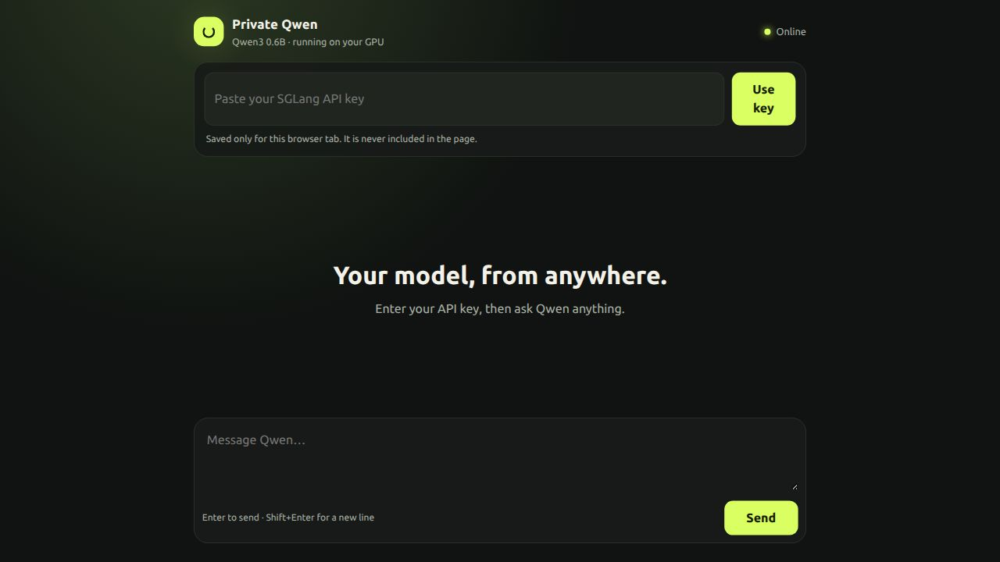
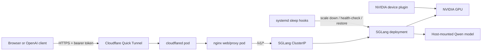

# Private Qwen 3 API on k3s

A self-hosted, OpenAI-compatible Qwen3 inference service for a single NVIDIA
GPU. The project combines SGLang, k3s, an authenticated browser client, and a
Cloudflare Quick Tunnel with GPU-aware laptop suspend and resume recovery.



## Highlights

- Serves `Qwen/Qwen3-0.6B` through SGLang's OpenAI-compatible API.
- Schedules one NVIDIA GPU through the Kubernetes device plugin.
- Keeps SGLang behind a `ClusterIP`; the web proxy is the only public route.
- Passes the bearer token from the browser without embedding it in the site.
- Uses startup, readiness, and liveness probes plus explicit resource limits.
- Stops CUDA work before suspend and checks driver health before restoring it.
- Includes a repeatable concurrency, throughput, and latency benchmark.

## Architecture



The random Quick Tunnel URL is convenient for a homelab demonstration, but it
has no uptime guarantee and changes when the connector pod is recreated.

## Prerequisites

- An Ubuntu/Debian host with a supported NVIDIA GPU and working `nvidia-smi`.
- Docker installed and managed by systemd.
- `curl`, `openssl`, Python 3, and at least 4 GB of free disk space.
- A user with `sudo` access.
- The Hugging Face CLI (`hf` or `huggingface-cli`) for downloading the model.

The deployment is designed for one k3s node and one GPU. Review the resource
requests in `deploy/k3s/sglang.yaml` before using a smaller machine.

## Quick start

### 1. Download the model

Model weights are deliberately excluded from Git. The downloader pins the
upstream revision used by this project:

```bash
python3 -m pip install --user 'huggingface_hub[cli]'
./scripts/download-model.sh
```

To store the model elsewhere, provide an absolute directory:

```bash
MODEL_DIR=/srv/models/Qwen3-0.6B ./scripts/download-model.sh
```

### 2. Install the host runtime and k3s

```bash
chmod +x scripts/*.sh
./scripts/install-host.sh
```

The installer adds NVIDIA Container Toolkit 1.20.0, configures Docker's NVIDIA
runtime, and installs single-node k3s without Traefik or ServiceLB. k3s uses its
bundled containerd; Docker remains useful for local image checks.

Create a user-owned kubeconfig so later commands do not require `sudo`:

```bash
mkdir -p ~/.kube
sudo install -o "$USER" -g "$USER" -m 600 /etc/rancher/k3s/k3s.yaml ~/.kube/config
export KUBECONFIG="$HOME/.kube/config"
kubectl get nodes
```

### 3. Configure the API key and deploy

```bash
./scripts/configure-secrets.sh
./scripts/deploy.sh
```

The secret setup prompts without echoing. Leaving the prompt blank generates a
random 256-bit key and prints it once; save it in a password manager.

`deploy.sh` defaults to `models/Qwen3-0.6B` in this checkout. A model stored
elsewhere can be selected without editing Kubernetes YAML:

```bash
MODEL_PATH=/srv/models/Qwen3-0.6B ./scripts/deploy.sh
```

`MODEL_PATH` must be absolute because k3s mounts it from the host.

### 4. Verify the deployment

```bash
./scripts/test-local.sh
```

`deploy.sh` prints the generated `https://...trycloudflare.com` URL. Open it in
a browser for the chat interface, or call the API directly:

```bash
curl https://YOUR-RANDOM-NAME.trycloudflare.com/v1/chat/completions \
  -H 'Authorization: Bearer YOUR_SGLANG_API_KEY' \
  -H 'Content-Type: application/json' \
  -d '{
    "model":"qwen3-0.6b",
    "messages":[{"role":"user","content":"Hello from my phone"}],
    "stream":false
  }'
```

For an OpenAI-compatible client, append `/v1` to the tunnel URL, use the saved
token as the API key, and set the model to `qwen3-0.6b`. The browser interface
stores the token only in that tab's session storage. Quick Tunnels do not
support SSE, so public requests must use `"stream": false`.

## Benchmarking

Start a port-forward, export the same API key, and run the benchmark:

```bash
kubectl -n llm port-forward service/sglang 30000:30000
export SGLANG_API_KEY='your-key'
python3 scripts/profile-sglang.py \
  --requests 24 \
  --concurrency 4 \
  --input-words 192 \
  --output-tokens 128 \
  --label qwen3-0.6b-c4
```

The JSON result includes request throughput, output and total token throughput,
mean latency, p50/p95 latency, and token counts. Record the GPU model, driver,
SGLang version, and command alongside results so comparisons remain meaningful.

## Operations

```bash
sudo k3s kubectl -n llm get pods
sudo k3s kubectl -n llm logs deployment/sglang -f
sudo k3s kubectl -n llm logs deployment/cloudflared -f
sudo k3s kubectl -n llm rollout restart deployment/sglang
```

### Laptop suspend and resume

An active CUDA process can leave the NVIDIA GPU requiring a reboot after the
laptop resumes. Install the integration once:

```bash
sudo ./scripts/install-sleep-recovery.sh
```

Before sleep, the hook scales SGLang to zero, waits for its pod to disappear,
and confirms that no compute process owns the GPU. A failed check cancels
suspend. After wake, it validates `nvidia-smi`, restarts the device plugin, and
then restores SGLang. If the driver is unhealthy, SGLang remains at zero rather
than starting against a dead GPU.

The web and connector pods remain running. The URL is preserved when the
existing tunnel connection survives sleep, but inference is unavailable while
the laptop sleeps and while the model reloads.

## Troubleshooting

### SGLang pod stays Pending

Check that Kubernetes sees an allocatable GPU and inspect scheduling events:

```bash
kubectl get node -o custom-columns='NAME:.metadata.name,GPU:.status.allocatable.nvidia\.com/gpu'
kubectl -n llm describe pod -l app=sglang
kubectl -n nvidia-device-plugin logs daemonset/nvidia-device-plugin
```

If the GPU count is empty, verify `nvidia-smi`, the NVIDIA container runtime,
and the device-plugin pod before restarting SGLang.

### Model directory errors

`MODEL_PATH` must be an absolute path on the k3s node and must contain
`config.json`. Run `./scripts/download-model.sh`, or deploy with the location of
an existing checkout. Inspect the effective mount with:

```bash
kubectl -n llm get deployment sglang \
  -o jsonpath='{.spec.template.spec.volumes[?(@.name=="model-cache")].hostPath.path}'
echo
```

### The API returns 401

Use the value entered or generated by `configure-secrets.sh`. To deliberately
replace it, rerun that script and restart the SGLang deployment.

### No public URL appears

Wait for the connector and inspect its logs:

```bash
kubectl -n llm rollout status deployment/cloudflared --timeout=5m
kubectl -n llm logs deployment/cloudflared
```

Restarting `cloudflared` creates a different random Quick Tunnel URL.

### Resume does not restore inference

Inspect the sleep hook and kernel logs:

```bash
journalctl -b -t sglang-gpu-sleep
journalctl -b -k | grep -E 'NVRM|Xid'
```

Reboot if the NVIDIA driver reports an Xid that requires node recovery.

## Security and limitations

- The API requires a bearer token, but Quick Tunnels are intended for testing,
  not production availability.
- The model is mounted read-only and SGLang is not exposed as a `NodePort` or
  `LoadBalancer`.
- `cloudflared` currently follows `latest`; pin a tested version or digest for
  a long-lived deployment.
- This repository's source code is MIT-licensed. Qwen model files are fetched
  separately and remain subject to their upstream license.

## License

[MIT](LICENSE)
